# Compte rendu du TP1 : Observer HTTP du navigateur à Wireshark

## Partie 1 : Observer dans le navigateur

### Étape 1 : Une requête simple

| Élément à relever | Où le trouver | Valeur observée |
| --- | --- | --- |
| Méthode | En-têtes, ligne de requête | GET |
| URL complète | En-têtes | http://localhost/TP1_Observer_HTTP/formulaire.php |
| Code de statut | En-têtes, ligne de statut | 200 |
| Version de HTTP | En-têtes | HTTP/1.1 |
| Host | En-têtes de requête | localhost |
| User-Agent | En-têtes de requête | Mozilla/5.0 (Windows NT 10.0; Win64; x64) AppleWebKit/537.36 (KHTML, like Gecko) Chrome/157.0.0.0 Safari/537.36 |
| Content-Type | En-têtes de réponse | text/html; charset=UTF-8 |
| Content-Length | En-têtes de réponse | 387 |
| Server | En-têtes de réponse | Apache/2.4.65 (Win64) OpenSSL/3.5.1 PHP/8.4.27 |
| Durée totale | Onglet Délais (Timings) | 21.17 ms |

### Étape 3 : Envoyer en POST

`Content-Type: application/x-www-form-urlencoded`

### Étape 4 : Une erreur 404

Code de statut : **404**

Ce qu'affiche la page :

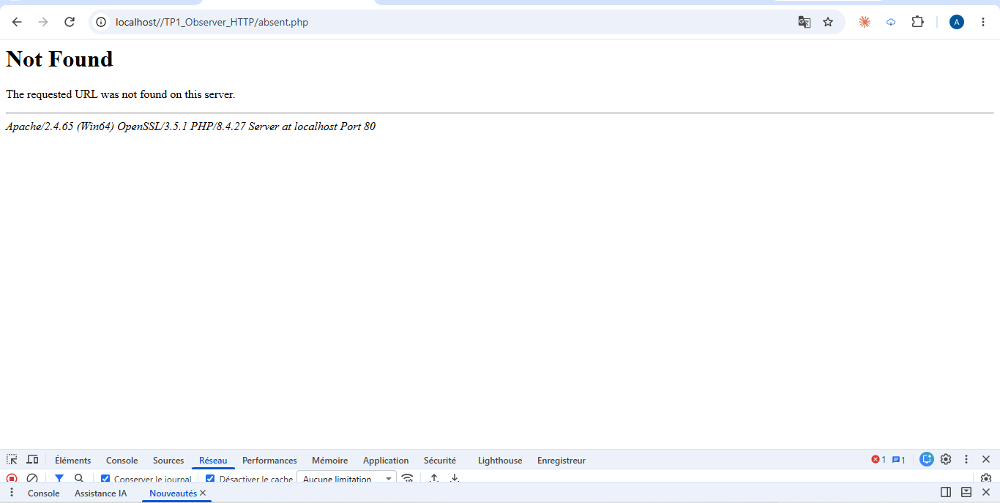

### Étape 5 : Une redirection

- Code de la requête : **302**
- `Location: formulaire.php`

**Explication :** quand le navigateur a envoyé la requête `GET http://localhost/TP1_Observer_HTTP/redirige.php`, le serveur a répondu avec un code de redirection 302 qui l'envoie vers `formulaire.php`. Le navigateur a alors fait automatiquement une nouvelle requête vers cette page.

### Étape 6 : Le cache (304)

- Code : **304**
- `If-Modified-Since: Sat, 21 Nov 2026 15:18:00 GMT`
- `If-None-Match: "0-660caddc23275"`

### Étape 7 : Un vrai site

| Élément | Valeur |
| --- | --- |
| Nombre de requêtes | 7 |
| Volume transféré | 129 ko |
| Temps de chargement complet | 810 ms |
| Version HTTP | h2 |

## Partie 2 : Installer Wireshark

Preuve d'installation (Windows) :

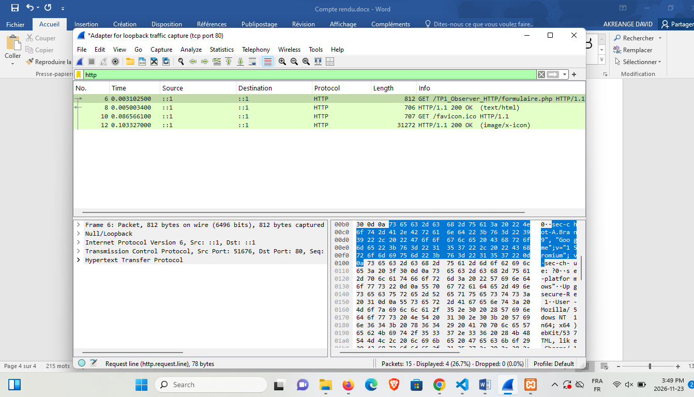

## Partie 3 : Capturer et analyser avec Wireshark

### Étape 1 : Choisir l'interface

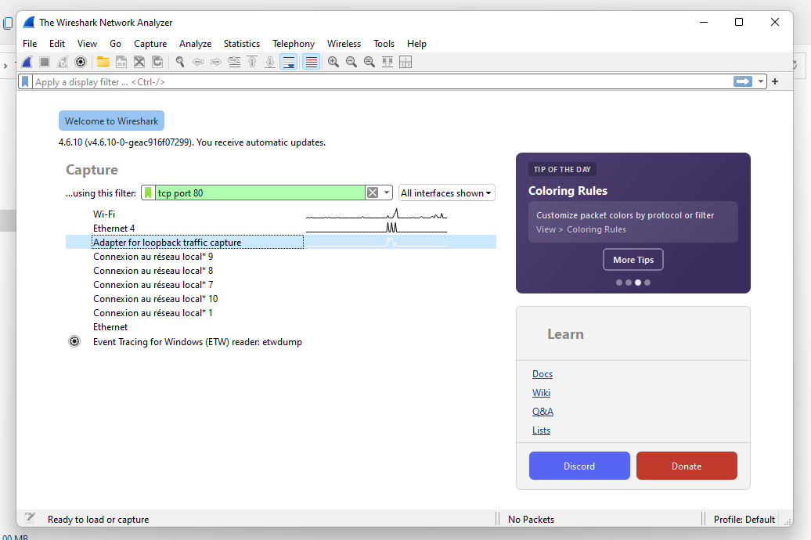

### Étape 2 : Lancer une capture

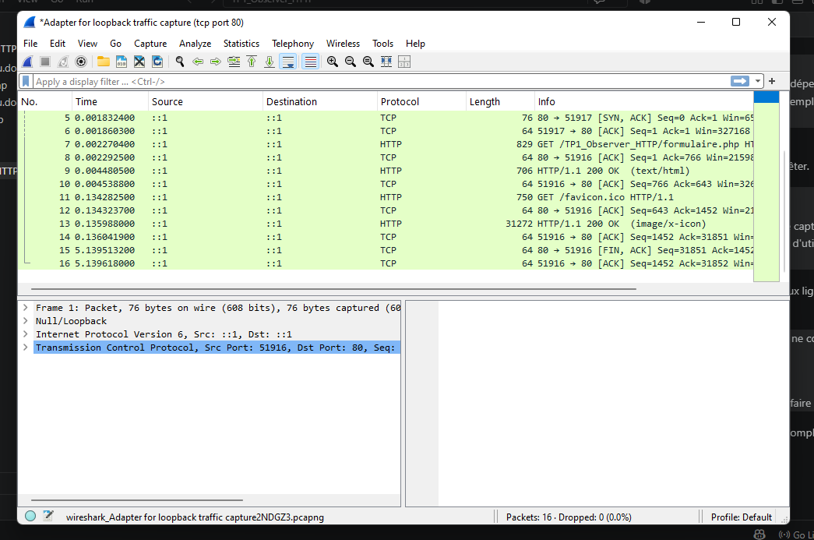

### Étape 3 : Filtrer

Avant filtrage :

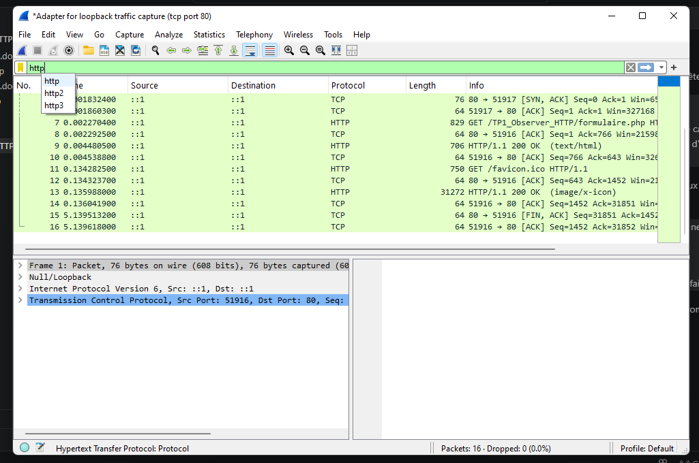

Après filtrage (`http`) :

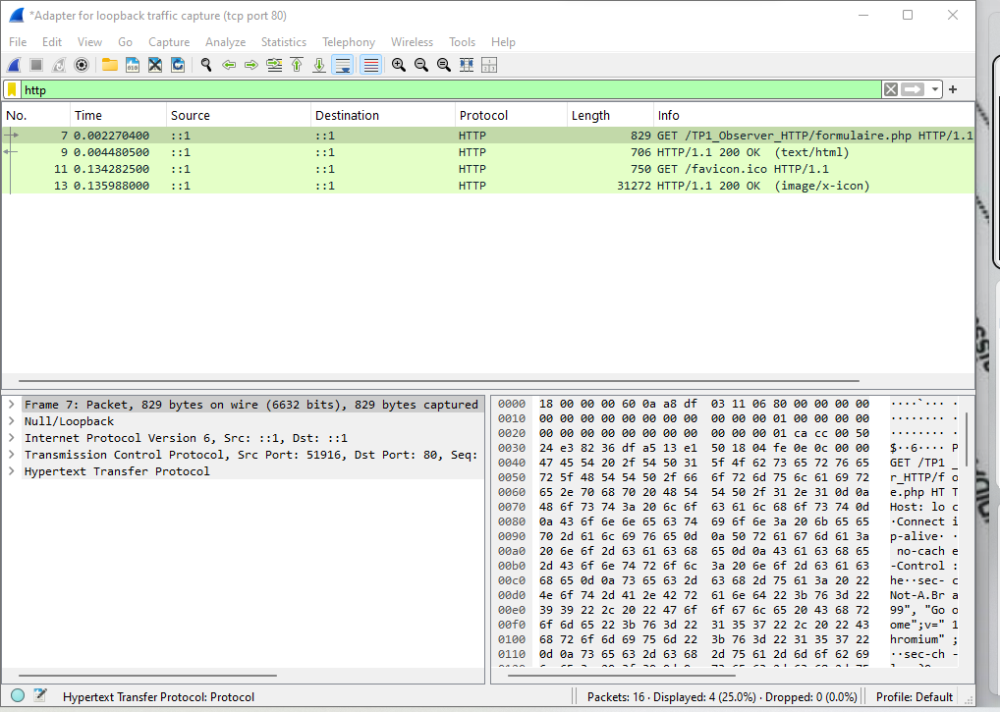

### Étape 4 : Lire les couches

| Couche (cours, ch. 1.4) | Ligne dans Wireshark | Information à relever | Information relevée |
| --- | --- | --- | --- |
| Accès réseau | Null/Loopback ou Ethernet II | Type de trame | Family: IPv6 (24) |
| Internet | Internet Protocol | Adresse source | ::1 |
| | | Adresse destination | ::1 |
| Transport | Transmission Control Protocol | Port source | 51916 |
| | | Port destination | 80 |
| Application | Hypertext Transfer Protocol | Méthode | GET |
| | | Chemin | /TP1_Observer_HTTP/formulaire.php |
| | | En-têtes | Voir image ci-dessous |

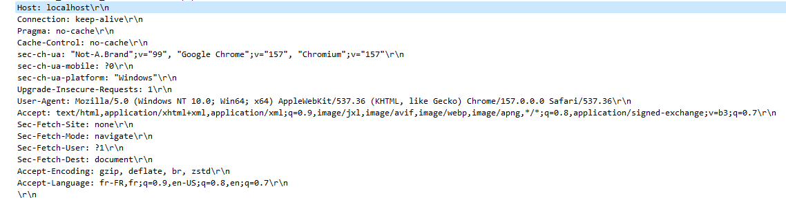

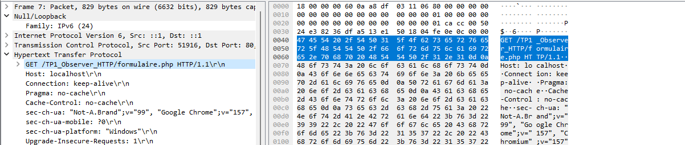

*Figure 1 : octets de la requête HTTP*

### Étape 5 : La connexion TCP

Paquet **[SYN]** :

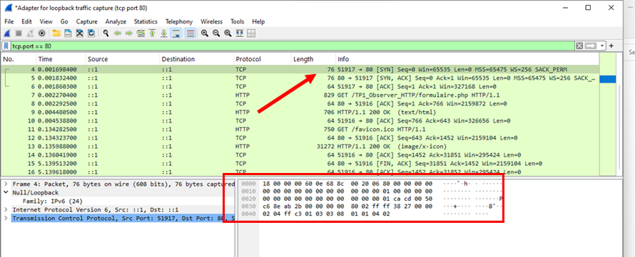

Paquet **[SYN, ACK]** :

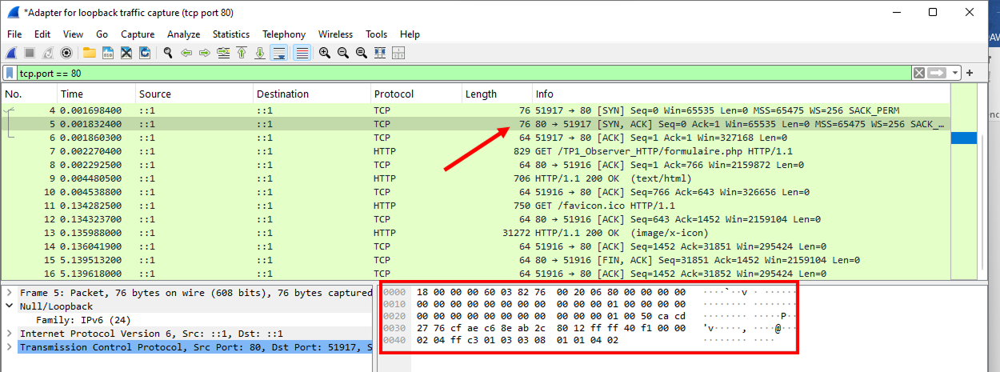

Paquet **[ACK]** :

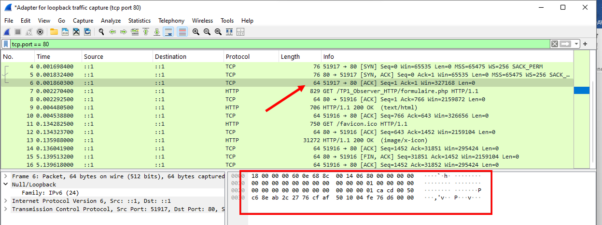

Paquet **[FIN, ACK]** :

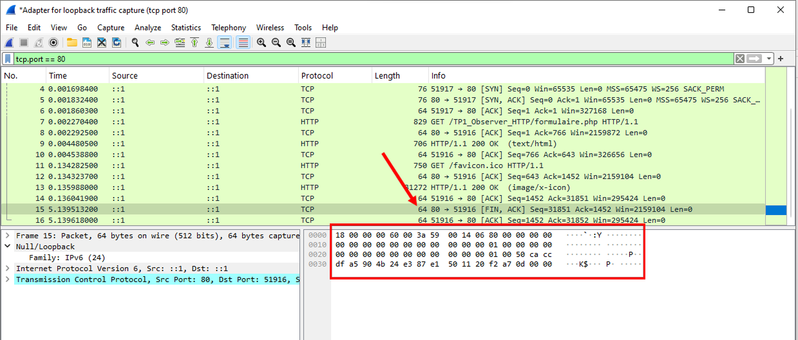

**Version dessinée du dialogue client – Serveur :**


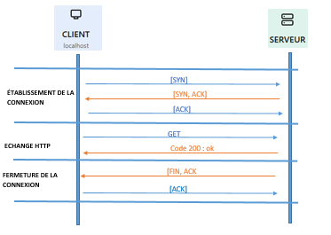


### Étape 6 : Suivre le flux

Les en-têtes de requête et de réponse observés dans Wireshark et dans l'outil du navigateur sont les mêmes.

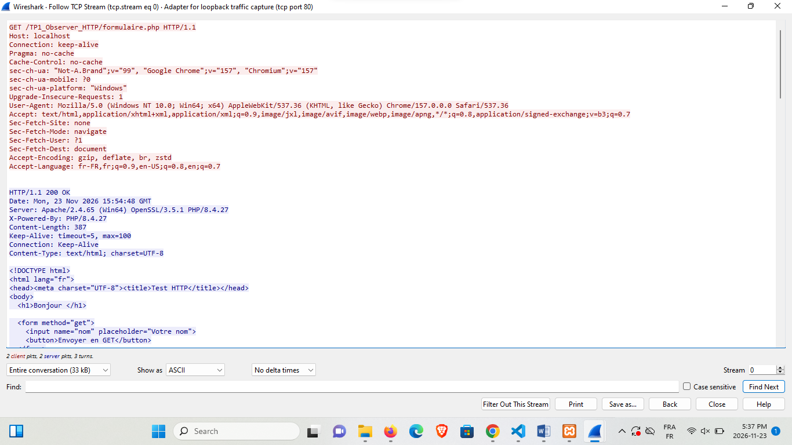

### Étape 7 : Voir un formulaire passer

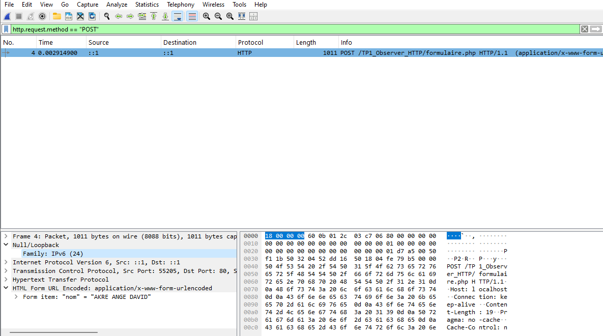

### Étape 8 : La résolution DNS

L'adresse IP affichée dans Wireshark est la même que celle donnée par `nslookup`.

### Étape 9 : Ce que change HTTPS

- **Client Hello** : en dépliant *Transport Layer Security* > *Handshake Protocol: Client Hello* > *Extension: server_name*, on trouve `Server Name: fr.wikipedia.org`. Le nom du site visité reste visible.
- **Application Data** : le contenu est illisible (*Encrypted Application Data*). On ne voit ni l'URL complète, ni les en-têtes, ni les données.

| Ce qui reste **visible** en HTTPS | Ce qui est **chiffré** |
| --- | --- |
| Le nom du site (SNI dans le Client Hello) | L'URL complète (chemin, paramètres) |
| Les adresses IP source et destination | Les en-têtes HTTP (cookies, User-Agent…) |
| Le volume échangé (taille et nombre de paquets) | Le contenu des pages et des formulaires |

Contrairement à l'étape 7, où le nom saisi dans le formulaire apparaissait en clair, ici rien n'est lisible.

### Étape 10 : Enregistrer

La capture de l'étape 9 est enregistrée dans `captures/tp2-http.pcapng`.

## Questions

**1. Pourquoi dit-on que HTTP est sans état ? Qu'est-ce qui permet malgré tout au serveur de reconnaître un visiteur ?**

Parce que chaque requête est traitée seule : le serveur ne se souvient pas des requêtes précédentes. Pour reconnaître un visiteur, on utilise les **cookies**. Le serveur envoie un identifiant de session (par exemple `Set-Cookie: PHPSESSID=...` avec PHP), et le navigateur le renvoie à chaque requête suivante.

**2. Où se trouvent les données d'un formulaire envoyé en GET ? En POST ? L'une des deux est-elle sûre sans HTTPS ?**

En GET, elles sont dans l'URL (`formulaire.php?nom=...`). En POST, elles sont dans le corps de la requête. Aucune des deux n'est sûre sans HTTPS : POST les cache seulement de la barre d'adresse, mais on peut les lire en clair dans Wireshark .

**3. Que contient la réponse à une requête `HEAD` ?**

Seulement la ligne de statut et les en-têtes, sans le corps de la page. Testé avec `curl.exe -I http://localhost/TP1_Observer_HTTP/formulaire.php` :

```
HTTP/1.1 200 OK
Date: Tue, 24 Nov 2026 01:27:49 GMT
Server: Apache/2.4.65 (Win64) OpenSSL/3.5.1 PHP/8.4.27
X-Powered-By: PHP/8.4.27
Content-Type: text/html; charset=UTF-8
```

Le corps reçu fait 0 octet avec `HEAD`, contre 387 octets pour la même page avec `GET` (la même valeur que le `Content-Length` relevé en partie 1).

**4. Combien de paquets faut-il pour ouvrir une connexion TCP ? À quoi sert chacun ?**

Trois paquets (la poignée de main en trois temps) :

- **SYN** : le client demande l'ouverture de la connexion.
- **SYN, ACK** : le serveur accepte et le confirme.
- **ACK** : le client confirme à son tour. La connexion est ouverte et la requête HTTP peut partir.

On les retrouve aussi dans la capture HTTPS (`tp2-http.pcapng`, paquets 65, 70 et 71) avant le Client Hello vers Wikipédia.

**5. Quelles informations Wireshark montre-t-il pour un site en HTTPS, et lesquelles cache-t-il ?**

Il montre le nom du site (dans le Client Hello, ici `fr.wikipedia.org`), les adresses IP, les ports et la quantité de données échangées. Il cache tout le reste : l'URL complète, les en-têtes, les cookies et le contenu des pages et des formulaires.
